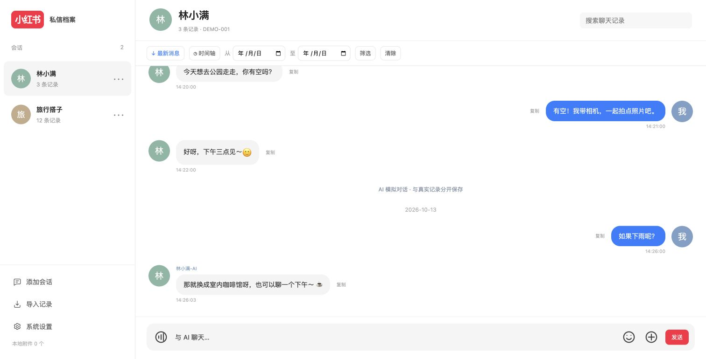
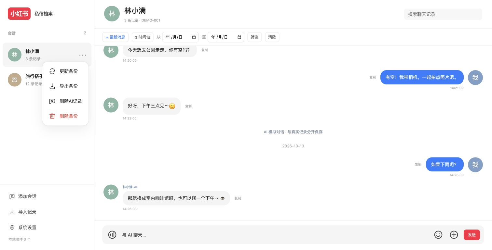

# RedNote Chat Archive Skill · 小红书本地聊天档案

[中文](README.md) | [English](README.en.md)

在自己的 Mac 上备份和查看小红书聊天记录，并用历史文字样本进行 AI 聊天风格模拟。真实聊天与 AI 对话分别保存，网页只在本机运行。

这是持续开发中的个人本地项目：**备份范围是小红书已经同步到 Mac 的数据，不保证包含服务器上的全部历史记录。** 此发布版包含可安装的维护Skill及配套本地应用源码，不包含私人运行数据。

## 界面预览（虚拟数据）

以下浏览器截图仅使用编写的示例会话、DEMO账号、代码生成头像和模拟AI回复；不读取真实聊天数据库、头像、附件或API密钥，不调用模型服务。





截图可通过 `python3 demo_preview.py` 在 http://127.0.0.1:8770/ 重现。该只读预览拒绝所有POST，不支持发送、更新或删除；测试完用Ctrl+C停止。它不改变正式服务或真实数据。

## 功能

### 真实聊天备份

- 输入小红书号、内部用户ID或用户主页链接，匹配本地会话并添加到左侧列表。
- 备份原始数据库快照、完整原始消息字段及归一化聊天记录。
- 文字、表情、图片、语音、视频、通话、系统提示、撤回提示和分享卡片。
- 附件保存本地，语音/视频转换为浏览器兼容格式，支持播放和另存为。
- 会话更多菜单更新消息并下载新增附件，导出仅该联系人的真实聊天JSON。
- JSON/CSV导入，按源消息ID或普通导入字段去重。

### 聊天界面

- 真实圆形头像，白色背景，我的蓝色气泡、对方灰色气泡；正文与输入框14px。
- 聊天正序，打开定位最新消息；向上自动加载更早200条，保持阅读位置。
- 关键词搜索、时间轴和日期范围筛选；时间轴准确定位所选日期的第一条真实消息，不再滚到AI区域。没有当天记录时提示实际定位日期；日期定位会清除原搜索/日期筛选。“最新消息”快速返回底部。
- 气泡旁复制/保存；系统消息居中灰字；通话显示电话图标和状态。
- 消息时间按北京时间显示：今天为时分秒，本周其他日期为“周几 时分秒”，非本周为“YYYY-MM-DD 时分秒”；本周从周一开始。真实消息、AI消息和系统提示采用同一规则。
- 分享卡片显示封面、标题、作者及视频标识；点击打开小红书原链接。
- 原生小红书表情选择器，缺失图片时使用系统emoji。

### AI聊天

- 可选择 **OpenAI API** 或 **DeepSeek API**，各自独立保存密钥和模型配置。
- 只以对方原话作为风格示例，你的消息作为接话背景；参考句长、称呼、语气词、表情和近期话题。
- 以部分历史样本及近期AI对话生成回复，不是完整训练，也不代表本人当前真实情绪。
- 回复显示 **名字-AI**；不会向小红书发送消息。
- AI数据保存在独立SQLite库，真实备份及导出不包含AI消息。
- 默认保存 **1天**；可选 **7天、30天、60天、永久**；按会话删除AI记录。
- 点击发送后，你的消息立即显示，下方先展示对方头像、名字-AI和“回复中…”；收到回复后替换占位，不重复插入。
- 回复失败时占位显示错误、标记发送未完成并恢复输入草稿；仅成功的消息对写入AI数据库。
- 超时、密钥、余额、限流、网络错误明确提示。

### 访问保护

- 不设置密码时直接查看；设置后先解锁，支持更改/移除密码及立即锁定。
- 密码用scrypt加盐散列保存；会话有效8小时，重启服务需重新解锁。
- 锁定保护聊天、附件、导出、更新及AI接口。**访问密码不加密磁盘数据库。**

## 运行条件

- Python 3.10+，使用标准库，无需安装Python第三方依赖。
- Mac已安装并登录小红书，且本地存在当前适配的PrivateMessage.db。
- ffmpeg、ffprobe可执行：用于语音/视频转换与验证。未安装时可通过自己的包管理器安装，例如 `brew install ffmpeg`。
- AI服务需要可用的API密钥、对应模型权限、额度及网络连接。

网页可查看普通导入文件，Mac客户端数据库提取则依赖相应版本的表结构。没有Windows/Android/iPhone直接提取器。

## 启动

```sh
cd /path/to/red_note
python3 app.py
```

访问 [本地网页](http://127.0.0.1:8765/)，在终端按Ctrl+C停止。HTML/CSS/JS改动后刷新；Python改动后重启。不要将服务监听地址改为公网后直接用于远程分享。

### 第一次备份

1. 在Mac小红书打开目标联系人的主页和聊天，加载所需历史。
2. 程序尝试发现唯一的Mac源数据库；有多个容器或无法识别时，通过 `REDNOTE_SOURCE_DB` 环境变量指定实际PrivateMessage.db路径，再启动服务。
3. 如系统拒绝读取应用容器，给实际运行服务的程序配置必要的文件访问权限。
4. 左侧点击“添加会话”，输入小红书号或主页链接。
5. 等待消息备份和附件下载完成，再检查时间范围和失败附件数量。

公开小红书号不等于24位内部ID，缓存未提供关联时无法自动解析。程序不会按昵称猜测；可以提供含 `/user/profile/<内部ID>` 的主页链接。支持粘贴小红书主页短分享链接或整段分享文案：读取首次跳转的主页内部ID，并匹配本地会话；链接无法访问或不是用户主页时会提示原因。缓存解析支持数据库内响应及磁盘响应文件。

每会话「•••」菜单：更新备份、导出备份、删除AI记录、删除备份。多个备份任务不能同时启动，需等待前一个完成。

## 配置AI

在 **系统设置 → AI聊天** 选择服务、填写API Key及模型名称，保存后用底部输入框聊天。

| 服务 | 默认模型 | 接口/密钥入口 |
| --- | --- | --- |
| OpenAI API | `gpt-4.1-mini` | [API Keys](https://platform.openai.com/api-keys) · [Responses文档](https://developers.openai.com/api/docs/guides/text) |
| DeepSeek API | `deepseek-flash` | [DeepSeek平台](https://platform.deepseek.com/) · [Chat Completions文档](https://api-docs.deepseek.com/api/create-chat-completion/) |

模型名称可修改，默认名称不保证所有账号都可调用。ChatGPT Plus不包含普通API Key的调用额度；API余额、费用和限额在对应服务商平台管理。

密钥只在本机服务端使用，保存于 `data/ai_config.json`（0600权限）。界面不会回传已保存的密钥；输入留空表示保留。也支持服务启动环境中的 `OPENAI_API_KEY`、`DEEPSEEK_API_KEY`。不要将密钥写在命令行参数、Git或公开聊天中。

**选择服务并发送AI消息时，当前联系人的部分历史文字及近期AI上下文会发送给所选服务。** 本地真实档案不是全部上传；服务商的数据处理政策仍适用。OpenAI请求设置store:false不代表服务商不存在其他保留机制。

### AI记录保存时效

- 默认1天，按每条消息创建时间计算，24小时后过期。
- 服务运行时每30秒清理，读取AI历史时也清理。
- 服务关闭时不执行清理；关闭期间到期的消息在下一次启动时清除。
- 修改时效后立即按创建时间重新计算，删除已过期消息。
- 永久表示不自动过期，仍可手动按会话删除。
- 删除需网页确认，仅影响AI库；生成中的迟到回复不会恢复已删除记录。

## 导入与附件保存

JSON数组，或包含messages数组的对象：

```json
[
  {
    "contact": "示例联系人",
    "sender": "我",
    "time": "2026-10-12 10:00:00",
    "content": "这是一条虚构消息"
  }
]
```

CSV使用UTF-8，表头为 `contact,sender,time,content`。时间请统一为 `YYYY-MM-DD HH:mm:ss`，可附毫秒。未提供contact时使用导入框填写的联系人名称。单次上限20MB。

普通JSON/CSV不具有原小红书消息字段时，不能自动推断附件或原始消息类型。分享卡片预览不等于远程笔记视频已经备份。

附件“保存”优先浏览器原生另存为；不支持时填写本机完整绝对路径。目标文件夹必须存在，不覆盖已有同名文件。

## 数据与备份

| 位置 | 内容 |
| --- | --- |
| `data/chats.sqlite3` | 真实消息、原始字段、会话注册、附件索引 |
| `data/source-backups/` | 源数据库一致快照，可能包含多个联系人的记录 |
| `data/exports/` | 每会话JSON、原始JSON、范围报告 |
| `data/media/` | 原始附件及兼容播放文件 |
| `data/profiles.json` | 头像和表情映射 |
| `data/security.json` | 访问密码散列与salt |
| `data/ai_chats.sqlite3` | AI消息、保存时效、删除代数 |
| `data/ai_config.json` | 模型服务与API密钥 |

完整本地档案需同时备份真实数据库、media、exports和profiles。停止服务后复制，或使用SQLite backup API。JSON导出不打包附件，也不包含AI记录。`source-backups`是整库快照，不应对外分享。

## 代码结构与测试

```text
app.py                 本机HTTP服务与接口
contacts.py            身份识别与会话来源
export_rednote.py      真实聊天导出
media.py               附件增量下载与转换
sync_job.py            备份任务状态
security.py            密码与会话
ai_chat.py             独立AI数据、风格样本与模型调用
static/                HTML/CSS/JS
skills/rednote-chat-archive/       可复用维护技能与详细参考
```

```sh
python3 test_ai_chat.py
python3 test_providers.py
python3 test_app.py
python3 test_contacts.py
node --check static/app.js
```

AI测试使用模拟服务，不调用真实模型。HTTP测试使用临时数据库和本机临时端口。`test_contacts.py`使用合成schema及虚构数据，可在干净clone中运行。Node只用于语法检查，不是启动依赖。

## 本项目的Skill

详细维护指引在 [skills/rednote-chat-archive/SKILL.md](skills/rednote-chat-archive/SKILL.md)，按任务链接产品、架构、AI及运行参考文档。

它用于让后续开发助手延续现有约定。可将整个 `skills/rednote-chat-archive` 文件夹安装到自己的Codex skills目录；它不附带私人数据，也不保证在没有本项目源码时独立提供应用。此次只是保存到项目中，没有安装到全局目录。

## 发布范围与安装

本仓库包含应用源码以及 `skills/rednote-chat-archive/` 中的维护Skill。将此文件夹复制到 `~/.codex/skills/rednote-chat-archive/`，然后让助手使用 `$rednote-chat-archive` 维护本项目。Skill本身不是正在运行的备份服务；网页需要单独启动 `app.py`。

整个 `data/`、密钥、密码、聊天、附件及第三方表情资源均不随源码分发。源数据库由环境变量或唯一容器发现机制配置，不预设联系人。没有指定开源许可证，公开仓库不等于授予任意再分发许可。

```sh
# 可选：在自动发现不唯一时指定源数据库
export REDNOTE_SOURCE_DB="/path/to/PrivateMessage.db"
python3 app.py
# 命令行导出必须显式指定用户
python3 export_rednote.py --user '<小红书号或主页链接>'
```

## 已知限制

- 自动发现只接受唯一容器；多个候选需手动指定 `REDNOTE_SOURCE_DB`。
- 数据库schema随小红书版本变化，不能保证所有版本适用。
- 不直接提取iPhone，不恢复已删除聊天，不自动发送小红书消息。
- 表情只包含已接入的本地资源，不是完整官方表情库；部分原生互动动画不重现。
- AI风格是基于样本的近似模拟；不能声称克隆真人或掌握全部情感。
- 普通会话导出目前在前端筛选；AI显示在聊天末尾独立区域，不参与真实记录搜索/时间轴。
- 备份完成状态还需结合失败附件数检查；失败链接不一定可以重试恢复。

## 开发文档同步约定

每次新增、修改或移除功能，必须在同一任务中同步更新 README.md 与 skills/rednote-chat-archive/SKILL.md，并按涉及的功能更新对应 references。界面文案、交互、默认值、数据结构、配置、接口、运行方式和已知限制的变化都应反映到相关文档。文档描述最终实现，不把未完成的计划写成已有能力。

项目根目录 AGENTS.md 记录这一约定，供后续开发助手自动读取。

独立表情包在聊天中以100×100px区域等比显示，点击仍可查看大图；文字内表情大小保持原样。

每个会话更多菜单提供红色“删除备份”：输入当前访问密码二次确认（未设置密码需先设置），删除该会话的真实消息、原始元数据、AI记录、会话注册、项目导出及专属附件，并清理项目源数据库快照中的相关身份行。保留其他会话及共用附件；不修改小红书客户端源数据库，不删除外部另存文件。备份进行中禁止删除，密码错误不执行删除。删除无法撤销；重新添加会重新读取客户端仍保留的记录。

会话更多菜单根据最长选项自动撑开（width:max-content），浮层左右内边距均为6px、选项左右内边距均为14px，采用白色圆角浮层、细边框与柔和阴影，选项纵向排列，悬停浅灰底；更新、导出、删除AI记录和删除备份均配统一线框SVG图标，删除备份的图标及文字为红色。更多按钮为三点按钮，悬停、点击和展开时背景透明，键盘焦点保留轮廓提示。
